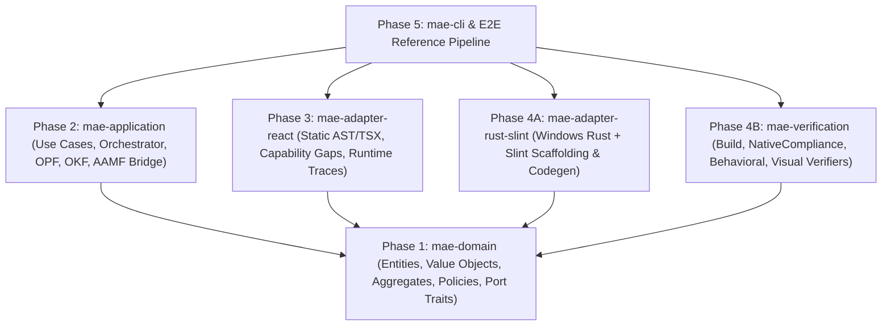

# MAE v0.1 Specification & Multiphase TDD Execution Plan
**Target Slice:** Frontend Migration (`React / TypeScript Web App` → `Native Windows / Desktop Rust + Slint App`)

## 1. Problem Statement

Migrating a modern frontend React + TypeScript application to a native desktop application in Rust + Slint for Windows (and cross-platform desktop) fails when treated as naive file-by-file syntax translation. React relies on component trees, hooks (`useState`, `useReducer`, `useEffect`), props, router state, CSS flex/grid layout, and browser APIs, whereas a native Rust + Slint Windows application requires a strict separation between Rust state/event/reducer/effect logic and declarative `.slint` UI components with native windowing (`windows_subsystem = "windows"`).

Furthermore, AI coding agents frequently self-certify broken or fake migrations (e.g., wrapping the web app in a WebView, dropping unsupported features silently, or claiming tests pass when evidence is stale).

## 2. Solution & Clean Architecture Design

MAE v0.1 implements a **DDD, OOP, SOLID, Clean Architecture** migration engine organized into 5 vertical-slice phases, each delivered via Red-Green-Refactor TDD in its own GitHub Pull Request and automerged into `main`:

---

## 3. Pre-Agreed TDD Seams (`mattpocock/skills` `/tdd` & `/codebase-design`)

1. **Seam 1 — Domain Policy & Aggregate Seam (`mae_domain` public API):**
   - *Catches:* Invalid task state transitions, acceptance with stale target revision evidence, acceptance with `Fail`/`Inconclusive`/`NotRun` contracts, acceptance with unaccepted dependencies, false completion when critical capability gaps exist, non-monotonic health score calculation, and plan-hash drift.
   - *Misses:* File I/O, external CLI process invocation.
2. **Seam 2 — Application Orchestration, OPF & OKF Seam (`mae_application` public API):**
   - *Catches:* Invalid OPF prompt frontmatter/variable rendering, missing prompt provenance digest, OKF bundle validation/search mismatches, AAMF wave-barrier scheduling bugs, checkpoint save/resume state corruption, and retry/repair loop routing.
   - *Misses:* Real React TSX syntax nuances or Rust compiler flags.
3. **Seam 3 — React Frontend Source Adapter Seam (`SourceAdapterPort` implemented by `ReactSourceAdapter`):**
   - *Catches:* Missing component/hook/prop/effect/route extraction from React `.tsx` sources, silent dropping of unsupported browser APIs (`window.localStorage`, `<canvas>`, dynamic CSS) instead of emitting `GapReasonCode` (`UI_BROWSER_ONLY_API`, `UI_CANVAS`, `UI_UNSUPPORTED_CSS`), and loss of provenance when merging Playwright runtime traces into `SemanticUiModel`.
4. **Seam 4 — Windows Rust + Slint Target Adapter & Independent Verification Seam (`TargetAdapterPort` & `VerifierPluginPort`):**
   - *Catches:* Missing Windows subsystem attribute (`#![cfg_attr(target_os = "windows", windows_subsystem = "windows")]`), business logic leaked into `.slint` files instead of Rust reducer modules, WebView/Electron/Tauri wrapper cheating caught by `NativeComplianceVerifier`, behavioral scenario mismatches in `BehavioralDifferentialVerifier`, unexecuted scenario hiding (`CoverageDisclosure`), and visual layout tolerance violations in `VisualParityVerifier`.
5. **Seam 5 — End-to-End Migration & Resilience Seam (`mae-cli` E2E runner):**
   - *Catches:* Integration regressions across all 9 MVP acceptance criteria from `docs/REACT_RUST_SLINT_MVP.md`, including deliberate failure injection → repair/retry recovery, checkpoint interruption/resume, and real `cargo test` compilation of the generated Rust + Slint target crate.

---

## 4. Multiphase Tracer-Bullet Tickets & PR Plan

### Phase 0 (Foundation Commit on `main`)
- Repository creation (`left-try/mae`), `GLOSSARY.md`, ADRs (`0001`, `0002`), `mattpocock/skills` + `DietrichGebert/ponytail` + migration skills in `.agents/skills/`, `migration.implementation-style` OPF prompt in `prompts/`, validated with `opf check` and `okf-agent bundle validate`.

### Phase 1 — PR #1: `feat/phase-1-domain-core`
- **Blocked by:** Phase 0
- **Scope (`crates/mae-domain`):**
  - Value Objects: `MigrationId`, `TaskId`, `ContractId`, `ArtifactId`, `ArtifactRevision`, `ContentHash`, `PlanHash`, `GapReasonCode` (all 11 UI codes), `CapabilityLevel`, `MigrationStrategy`, `VerificationCategory`, `VerificationStatus`, `ContractSeverity`, `TargetPlatform` (`WindowsDesktop`, `LinuxDesktop`, `CrossPlatformDesktop`).
  - Entities & IR Models: `Contract`, `CapabilityAssessment`, `MigrationGap`, `VersionedArtifact`, `SemanticUiModel` (`ComponentNode`, `StateField`, `EffectBinding`, `InteractionBinding`, `RouteDefinition`, `StyleToken`, `AssetEntry`), `EvidenceRecord`, `CoverageDisclosure`, `MigrationTask` (full state machine).
  - Aggregate Root: `MigrationAggregate` (manages task DAG, target revision bumps invalidating prior evidence, domain events).
  - Domain Policies: `AcceptancePolicy`, `CompletionPolicy`, `HealthScorePolicy`, `RecoveryPolicy`.
  - Port Traits: `SourceAdapterPort`, `TargetAdapterPort`, `VerifierPluginPort`, `PromptProviderPort`, `AgentBackendPort`, `ArtifactRepositoryPort`, `KnowledgeRepositoryPort`.
- **TDD Verification:** 25+ unit & invariant tests in `crates/mae-domain`.

### Phase 2 — PR #2: `feat/phase-2-application-integrations`
- **Blocked by:** Phase 1
- **Scope (`crates/mae-application`):**
  - `OpfPromptProvider` & `LegacyPromptProvider` (parses `opf.yaml` and `prompts/*.md`, validates `opf/0.2` frontmatter, renders `{{ context_path }}`, computes deterministic SHA-like content digest, records `PromptProvenance`).
  - `OkfKnowledgeRepository` (reads and validates `.okf/manifest.yaml` and section indexes, enforces `.okf-index/` isolation).
  - `AamfRuntimeBridge` & `AgentBackend` implementations (`CodexBackend`, `ClaudeCodeBackend`, `CopilotBackend`, `DeterministicMockBackend`) + `CheckpointStore` (deterministic JSON serialization and resume of wave/task state and artifact hashes).
  - `MigrationOrchestratorService` (drives discovery -> static analysis -> runtime capture -> plan hash -> wave execution -> independent verification -> repair loop -> completion gate).
- **TDD Verification:** Unit & integration tests covering OPF rendering, OKF validation, wave scheduling, checkpoint resume, and repair loop orchestration.

### Phase 3 — PR #3: `feat/phase-3-react-source-adapter`
- **Blocked by:** Phase 2
- **Scope (`crates/mae-adapter-react`):**
  - `ReactSourceAdapter` implementing `SourceAdapterPort`:
    - Stage A (`discover`): Parses `package.json`, `tsconfig.json`, and source tree into `SourceInventory` and `ModuleDependencyGraph`.
    - Stage B (`analyze_static`): Deterministic TSX/TS semantic extractor identifying components, props, `useState`/`useReducer` state fields, `useEffect` hooks, event handlers (`onClick`, `onSubmit`, `onChange`), routes, CSS tokens, and classifying browser-only gaps (`window.localStorage`, `navigator.geolocation`, `<canvas>`, complex CSS animations) with exact `GapReasonCode`s.
    - Stage C & D (`capture_runtime` & `assemble_semantic_ui`): Merges Playwright runtime traces and screenshot baselines with static semantics while preserving provenance.
- **TDD Verification:** Tests against multi-component React/TSX fixtures verifying deterministic artifact hashes, component/state/effect extraction, and gap reason codes.

### Phase 4 — PR #4: `feat/phase-4-rust-slint-windows-target-and-verifiers`
- **Blocked by:** Phase 3
- **Scope (`crates/mae-adapter-rust-slint` & `crates/mae-verification`):**
  - `RustSlintTargetAdapter` implementing `TargetAdapterPort`:
    - Generates native Windows/cross-platform Rust + Slint project (`Cargo.toml`, `build.rs`, `src/main.rs` with `#![cfg_attr(target_os = "windows", windows_subsystem = "windows")]`, `src/app/{mod,state,events,reducer,effects,navigation}.rs`, `ui/app.slint`, `ui/theme/tokens.slint`, and headless test suite).
  - `mae-verification` implementing `VerifierPluginPort`:
    - `NativeComplianceVerifier` (rejects WebView/Electron/Tauri/browser proxies; verifies Slint UI + Windows desktop subsystem).
    - `BuildVerifier` (validates Rust target compilation & test execution).
    - `BehavioralDifferentialVerifier` (compares normalized React vs Slint state/interaction traces and emits `CoverageDisclosure`).
    - `VisualParityVerifier` (validates geometry, spacing, colors, and screenshot deltas against configured tolerance).
- **TDD Verification:** Tests proving valid Rust+Slint codegen, rejection of WebView wrappers, differential behavior comparison, coverage disclosure, and visual tolerance checks.

### Phase 5 — PR #5: `feat/phase-5-cli-and-e2e-mvp`
- **Blocked by:** Phase 4
- **Scope (`crates/mae-cli` & `fixtures/react-rust-slint`):**
  - Reference React/TypeScript application fixture (`fixtures/react-rust-slint/source`) with 3 routes/views (`Dashboard`, `TaskDetail`, `Settings`), reusable components, local state, form input, filterable list, async mocked data load with loading/error/success states, CSS layout, icon asset, responsive rule, and an explicit browser-only API usage (`window.localStorage`) to exercise gap reporting.
  - `mae` CLI binary (`analyze`, `plan`, `migrate`, `verify`, `status`) and full E2E test harness verifying all 9 MVP acceptance criteria from `docs/REACT_RUST_SLINT_MVP.md` (including compiling and running `cargo test` on the generated Windows/Linux Rust+Slint target crate, deliberate verification failure -> repair -> re-verify -> accept, and interrupted checkpoint resume).
